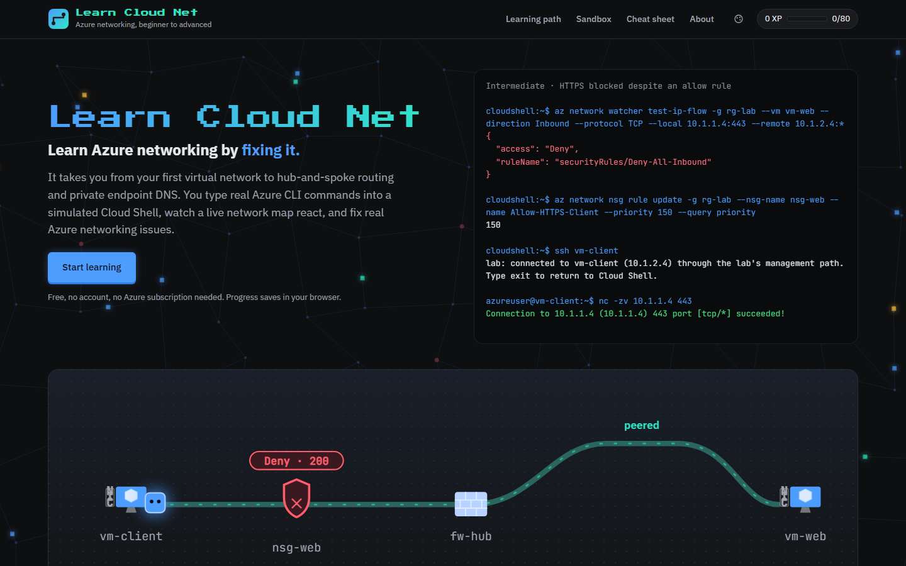

# Learn Cloud Net

Learn Azure networking by fixing it. **Play it at https://learncloudnet.com**



Learn Cloud Net is a free browser game for learning Azure networking. Each level gives you a small network, a problem, and a simulated Cloud Shell. Fix it with real Azure CLI commands or Portal-style forms, while a live network map shows where your packets go.

- **80 levels in four tiers:** Beginner (guided), Intermediate (break/fix), Advanced (several faults at once) and Expert (incidents with a clock).
- **Topics:** VNets and subnets, NSGs, routing, peering, hub and spoke, VPN gateways, private endpoints and DNS, NAT gateway, load balancers, Azure Firewall, Bastion and Network Watcher.
- **Linux or Windows VMs**, a sandbox, and a cheat sheet of every supported command.
- **No account, no Azure subscription, nothing to install.** Progress saves in your browser.

It's a simulator, not Azure. Its behavior follows Microsoft Learn, and each level links its sources.

## Run it locally

```bash
npm install
npm run dev
```

Built with Next.js, React, TypeScript and Vitest.

## Disclaimer

Learn Cloud Net is an independent project. It is not affiliated with, sponsored by, or endorsed by Microsoft in any way. Microsoft, Azure and related names are trademarks of the Microsoft group of companies.

## License

[MIT](LICENSE)
